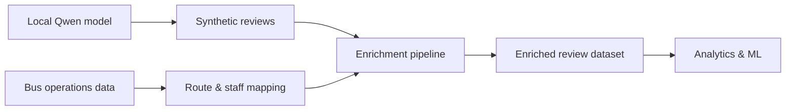

# 🚌 LokBus: Bus Operations & Passenger Experience Analytics

> Turning passenger feedback and daily bus operations into actionable service insights.

LokBus is a data-driven project for understanding bus-service quality at the level of routes, vehicles, drivers, conductors, and operating times. It combines synthetic passenger reviews generated with a local language model with operational assignment data, creating a structured foundation for sentiment analysis, issue tracking, and future transport dashboards.

## Overview

Public transport feedback is often unstructured and disconnected from the operational context that explains it. A complaint about overcrowding, harsh driving, or an unclean bus is much more useful when it can be connected to the relevant route, vehicle, trip time, driver, and conductor.

LokBus addresses this by:

- generating realistic passenger feedback across common bus-service categories;
- enriching each review with operational attributes from bus assignment data; and
- producing a clean, analysis-ready dataset for service-quality analytics and machine-learning experiments.

## Key Features

- **Synthetic passenger reviews** — 6,000+ natural-language bus reviews generated locally with Qwen 2.5 3B Instruct.
- **Service-quality categories** — feedback covering driving quality, disruptions, ticket handling, crowding, and bus maintenance.
- **Balanced feedback** — reviews include positive, negative, and mixed passenger experiences with ratings and sentiment-related fields.
- **Operational mapping** — reviews are linked to service date, route, vehicle, timestamp, driver, and conductor information.
- **Consistent identifiers** — generated driver and conductor names are associated with unique IDs for reliable downstream analysis.
- **Privacy-aware workflow** — the generation workflow runs locally on Apple Silicon using MLX; no review prompts need to be sent to a hosted model.
- **Analysis-ready output** — enriched CSV data can support dashboards, sentiment models, issue monitoring, and route-level comparisons.

## Data Flow



## Review Categories

| Category | Examples of feedback captured |
| --- | --- |
| Driving | Smooth driving, abrupt braking, speeding, dangerous overtaking |
| Disruptions | Traffic delays, missed stops, diversions, late arrival |
| Ticket handling | Fare collection, ticket availability, conductor behaviour |
| Crowding | Overcrowded buses, standing space, boarding difficulty |
| Bus maintenance | Cleanliness, damaged seats, broken hangers, bus condition |

## Technology Stack

| Component | Technology | Purpose |
| --- | --- | --- |
| Programming language | Python | Generation, processing, and data preparation |
| Local LLM runtime | MLX / `mlx_lm` | Efficient on-device inference on Apple Silicon |
| Language model | Qwen 2.5 3B Instruct | Synthetic passenger-review generation |
| Data processing | Pandas | CSV transformation, enrichment, and validation |
| Version control | Git & GitHub | Collaboration and project history |

## Project Structure

```text
LokBus/
├── generate_bus_reviews.py          # Generates synthetic passenger reviews
├── Bus_Reviews.py                   # Review-related processing utilities
├── busnroute.py                     # Bus and route data utilities
├── all_buses.json                   # Bus reference data
├── all_bus_observations.json        # Operational observation data
├── data/
│   ├── bus_review_mapper.py         # Maps reviews to operational records
│   ├── bus_reviews_enriched.csv     # Analysis-ready enriched reviews
│   └── ...                          # Supporting mapping data
└── README.md                        # Project documentation
```

## Dataset Design

Each enriched review is designed to combine passenger feedback with the operational context in which it occurred. Depending on the source record, fields include:

| Area | Example fields |
| --- | --- |
| Review | Review text, category, rating, sentiment, severity |
| Service | Service date, timestamp, time of day |
| Route | Route ID, route name, first stop, last stop |
| Vehicle | Assigned vehicle number |
| Staff | Driver ID/name and conductor ID/name |

This structure makes it possible to answer questions such as:

- Which routes receive the most maintenance-related complaints?
- Are crowding complaints concentrated at certain times of day?
- Does a vehicle repeatedly receive cleanliness or seat-condition feedback?
- Which service categories have the lowest average passenger ratings?

## Getting Started

### Prerequisites

- Python 3.10 or newer
- An Apple Silicon Mac is recommended for the MLX-based local generation workflow
- A local MLX-compatible Qwen model, if you intend to regenerate reviews

### Set up the environment

```bash
git clone https://github.com/16AbhinavReddy/LokBus.git
cd LokBus

python3 -m venv .venv
source .venv/bin/activate
pip install pandas mlx-lm
```

### Generate and enrich data

1. Configure the local model path in `generate_bus_reviews.py`.
2. Run the generator to create passenger-review records.
3. Use the review-mapping workflow in `data/bus_review_mapper.py` to attach route, vehicle, timestamp, driver, and conductor context.
4. Use the resulting enriched CSV for analysis or model development.

> The provided dataset can be explored directly; local model setup is only needed when generating a new review set.

## Current Scope

The current project delivers the data foundation for LokBus:

- locally generated passenger reviews;
- structured categories, ratings, and sentiment information;
- generated staff identities and identifiers; and
- review-to-operation mapping for downstream analytics.

## Future Enhancements

- Interactive route, vehicle, and staff performance dashboard
- Three-class sentiment classifier for new passenger reviews
- Issue alerts for recurring vehicle or route complaints
- Trend analysis by route, location, date, and time of day
- Passenger-facing feedback submission interface
- Recommendation system for operational improvement priorities

## Contributors

| Name | Role | Email | GitHub |
| :--- | :--- | :--- | :--- |
| **Tarun** | Developer | <26M0800@iitb.ac.in> | [Tarun2025-dev](https://github.com/Tarun2025-dev) |
| **Abhinav** | Developer | <26M0801@iitb.ac.in> | [16AbhinavReddy](https://github.com/16AbhinavReddy) |
| **Yashwanth** | Developer | <26M0794@iitb.ac.in> | [yashwanthsudi10](https://github.com/yashwanthsudi10) |

## License

Add a license before publishing or reusing the project outside the team. The MIT License is a common option for an open-source academic project.

